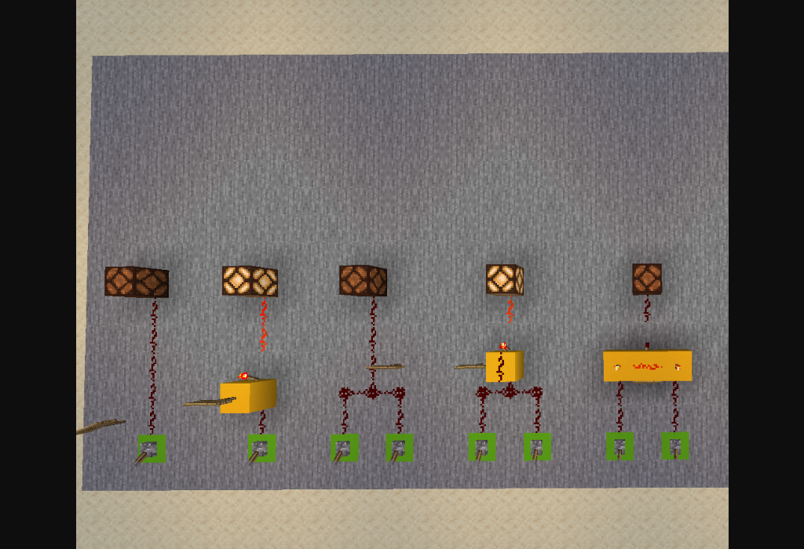
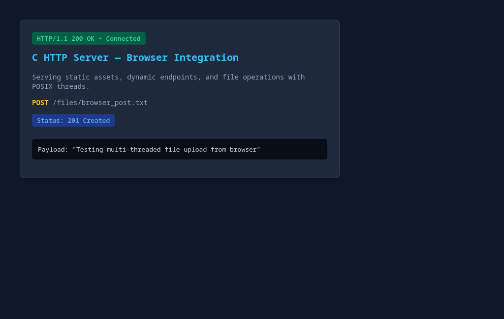
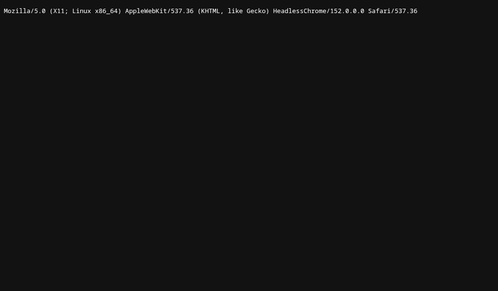

# HTTP Server in C

A lightweight, concurrent HTTP/1.1 server implemented in C using standard POSIX sockets, a bounded circular connection queue, and a worker thread pool. 

Built to handle simultaneous client connections, dynamic route dispatching, custom header extraction, and disk-backed file reads/writes with MIME-type detection.

---

## Architecture Overview

The server follows a **Producer-Consumer / Thread Pool** design to handle connections concurrently without blocking the main event loop.

```
                  ┌────────────────────────┐
                  │      Main Thread       │
                  │  socket, bind, listen  │
                  └───────────┬────────────┘
                              │ accept() loop
                              ▼
                  ┌────────────────────────┐
                  │ Thread-Safe Ring Buffer│
                  │  [ client_fd queue ]   │
                  │   mutex + semaphore    │
                  └───────────┬────────────┘
                              │ workers pop
         ┌────────────────────┼────────────────────┐
         ▼                    ▼                    ▼
  ┌─────────────┐      ┌─────────────┐      ┌─────────────┐
  │  Worker #1  │      │  Worker #2  │      │  Worker #N  │
  │ handle/recv │      │ handle/recv │      │ handle/recv │
  │    close    │      │    close    │      │    close    │
  └─────────────┘      └─────────────┘      └─────────────┘
```

1. **Main Listener**: Binds to port `4221` with a connection backlog of `128` (`SO_REUSEADDR` enabled). It accepts incoming client connections and immediately pushes the descriptor into the queue, unblocking itself for the next connection.
2. **Work Queue**: A circular buffer (`src/queue.c`) protected by a `pthread_mutex_t`. A counting semaphore (`sem_t queue_items`) tracks available items.
3. **Worker Pool**: A fixed pool of 8 worker threads (`src/workers.c`). Idle workers sleep on the semaphore with 0% CPU overhead, waking instantly when a connection arrives.
4. **Router & Protocol Engine**: Parses the HTTP request line and headers into an `HttpRequest` struct, dispatches to route handlers, and formats HTTP/1.1 response frames (`Content-Type`, `Content-Length`, status line, and body).

---

## Features

- **Concurrent Request Handling**: Fixed 8-thread worker pool capable of processing simultaneous connections out of order.
- **Dynamic URL Routing**: Parameter extraction on endpoints like `/echo/{str}`.
- **Header Parsing**: Extraction of request headers (`User-Agent`, `Content-Length`) using an in-out bounded search helper.
- **Static File Serving**: Serves disk files with automatic extension-based MIME type resolution (`.png`, `.jpg`, `.html`, `.txt`, `.svg`).
- **File Uploads**: Reads payload bytes up to `Content-Length` and writes files to disk, responding with `201 Created`.
- **Zero Socket Leaks**: Strict socket ownership where worker threads guarantee closure on all client paths.

---

## Endpoints

| Method | Endpoint | Description | Response Code |
| :--- | :--- | :--- | :--- |
| `GET` | `/` | Server homepage check | `200 OK` |
| `GET` | `/echo/{str}` | Returns `{str}` as plain text | `200 OK` |
| `GET` | `/user-agent` | Extracts and returns the caller's `User-Agent` | `200 OK` |
| `GET` | `/files/{filename}` | Reads file from base directory with resolved MIME type | `200 OK` / `404` |
| `POST` | `/files/{filename}` | Writes payload bytes to disk in the base directory | `201 Created` |
| `*` | *All other paths* | Default 404 handler | `404 Not Found` |

---

## Project Structure

```text
.
├── Makefile             # Build automation (all, debug, clean)
├── README.md            # Project documentation
├── docs/
│   └── screenshots/     # Browser verification captures
├── src/
│   ├── main.c           # Entry point, CLI args, socket setup, accept loop
│   ├── queue.c          # Thread-safe ring buffer implementation
│   ├── queue.h          # Queue interface
│   ├── utils.c          # HTTP request parser, route handlers, file I/O
│   ├── utils.h          # Data structures (HttpRequest) and handler prototypes
│   ├── workers.c        # Thread pool creation, worker loop, semaphore dispatch
│   └── workers.h        # Worker pool interface
└── temp/                # Default test directory for file storage
```

---

## Build & Run

### Prerequisites
- GCC / Clang
- POSIX-compliant environment (Linux / macOS)
- `pthread` library

### Compilation
```bash
# Standard build (optimizations enabled)
make

# Debug build (compiles with -g and -O0 for gdb / valgrind)
make debug

# Clean build artifacts
make clean
```
The executable is generated at `build/server`.

### Running the Server
```bash
# Start server with default settings
./build/server

# Specify a directory for file operations (GET and POST /files/...)
./build/server --directory ./temp
```

The server binds to `127.0.0.1:4221`.

---

## Browser Verification

The server handles browser requests directly, returning correct `Content-Type` headers for rendering or inline display.

### 1. Rendering Images Inline (`GET /files/mc_gates.png`)
Files ending in `.png` or `.jpg` are served with their respective image MIME types (`image/png`, `image/jpeg`) and `Content-Disposition: inline`, causing the browser to render them directly:



### 2. Serving HTML Pages (`GET /files/demo.html`)
HTML documents are served with `Content-Type: text/html`, rendering standard web interfaces:



### 3. Dynamic Echo Endpoint (`GET /echo/...`)
Dynamic path parameters are extracted and returned as `text/plain`:


### 4. Header Inspection (`GET /user-agent`)
The server extracts the browser's raw `User-Agent` header and echoes it back:



### 5. Serving Plain Text Files (`GET /files/test.txt`)
Text files are served as `text/plain`:


---

## Testing with CLI / cURL

### Echo Endpoint
```bash
curl -v http://localhost:4221/echo/hello
# Status: 200 OK
# Content-Type: text/plain
# Body: hello
```

### User-Agent Endpoint
```bash
curl -v -H "User-Agent: my-test-agent/1.0" http://localhost:4221/user-agent
# Status: 200 OK
# Body: my-test-agent/1.0
```

### File Upload (`POST`)
```bash
curl -v -d "Hello from curl" http://localhost:4221/files/sample.txt
# Status: 201 Created
```

### File Retrieval (`GET`)
```bash
curl -v http://localhost:4221/files/sample.txt
# Status: 200 OK
# Body: Hello from curl
```

### Concurrency Stress Test
Send 8 parallel requests simultaneously in the background:
```bash
curl -s http://localhost:4221/echo/1 & \
curl -s http://localhost:4221/echo/2 & \
curl -s http://localhost:4221/echo/3 & \
curl -s http://localhost:4221/echo/4 & \
curl -s http://localhost:4221/echo/5 & \
curl -s http://localhost:4221/echo/6 & \
curl -s http://localhost:4221/echo/7 & \
curl -s http://localhost:4221/echo/8 & \
wait
```
All requests execute concurrently across worker threads and finish non-blocking.
